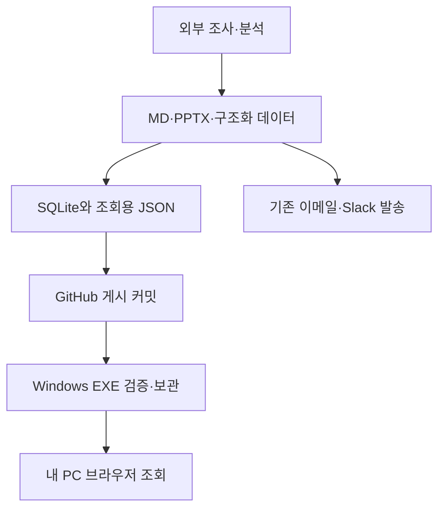
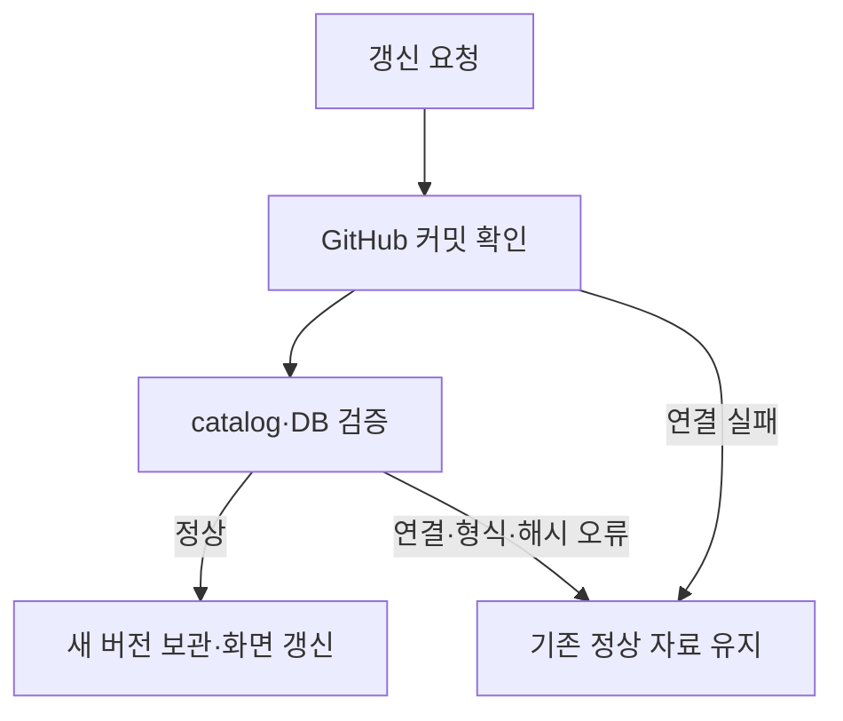

# DailyReportAnalysis 프로젝트 상세 설명서

문서 기준일: **2026-10-14** · 대상 버전: **v0.1.4**

DailyReportAnalysis는 회사의 Windows PC에서 자율주행·로보택시 데일리 리포트를 모아 보고, 검색하고, 사건의 흐름과 기업 간 관계를 확인하는 프로그램이다. 제품 화면의 이름은 **AV 리포트**, 설치된 바로가기의 이름은 **AV Report Hub**다.

이 문서는 비개발자 사용자, 프로젝트를 설명해야 하는 담당자, 데이터 게시자, 후속 개발자가 같은 기준으로 프로젝트를 이해하도록 작성했다. 현재 구현된 기능과 앞으로 연결할 기능을 구분한다. 문서의 동작 설명은 저장소의 소스 코드를 기준으로 한다.

## 목차

1. [만드는 이유와 목표](#1-만드는-이유와-목표)
2. [사용 대상과 운영 원칙](#2-사용-대상과-운영-원칙)
3. [현재 제공 범위](#3-현재-제공-범위)
4. [전체 구조와 역할 분담](#4-전체-구조와-역할-분담)
5. [자동 설치와 첫 실행](#5-자동-설치와-첫-실행)
6. [세 가지 화면과 이용 방법](#6-세-가지-화면과-이용-방법)
7. [검색·타임라인·관계의 의미](#7-검색타임라인관계의-의미)
8. [데이터베이스와 파일 구조](#8-데이터베이스와-파일-구조)
9. [과거 발송 리포트 편입](#9-과거-발송-리포트-편입)
10. [최신 자료 동기화](#10-최신-자료-동기화)
11. [리포트 제작·게시 절차](#11-리포트-제작게시-절차)
12. [로컬 서버와 보안 처리](#12-로컬-서버와-보안-처리)
13. [설정·운영·문제 해결](#13-설정운영문제-해결)
14. [구현 구조와 개발자 참고](#14-구현-구조와-개발자-참고)
15. [검증 방법과 검증 범위](#15-검증-방법과-검증-범위)
16. [현재 한계와 확장 방향](#16-현재-한계와-확장-방향)
17. [프로젝트 소개용 설명](#17-프로젝트-소개용-설명)

## 1. 만드는 이유와 목표

### 1.1 해결하려는 문제

데일리 리포트가 이메일과 첨부파일로만 쌓이면 특정 기업의 과거 동향을 찾기 위해 여러 메일을 열어야 한다. 같은 기업이 등장하더라도 제휴 발표, 시험 운행, 상용 허가, 안전요원 제거는 서로 다른 단계다. 날짜별 문서를 읽는 것만으로는 어떤 계획이 실제 실행됐는지 추적하기 어렵다.

회사 PC에서는 AI를 이용한 해석이나 분석을 수행할 수 없다는 제약도 있다. 사용자에게 Git, Python, Node.js, DB 서버 설치를 요구하는 방식은 일상적인 보고서 열람 도구로 적합하지 않다.

### 1.2 프로젝트의 목표

- 매일 발송된 리포트를 한 화면에서 날짜별로 찾는다.
- 기업명·지역·기술·규제 등 본문 키워드로 과거 자료를 검색한다.
- 선택한 리포트의 출처와 연관 자료를 함께 확인한다.
- 사건의 발생일, 보도 확인일, 예정일, 보고일을 구분한다.
- 기업·인물·지역 사이의 확인된 관계를 그래프로 보여준다.
- 조사와 관계 해석은 외부 제작 단계에서 끝내고 회사 PC에서는 준비된 데이터를 조회한다.
- 설치 파일 하나를 실행하면 일반 사용자가 별도 개발 환경을 준비하지 않아도 시작할 수 있게 한다.

### 1.3 이 프로그램이 담당하는 일

이 프로그램은 리포트를 **보관·배포·조회**하는 도구다. 현재 Windows 실행 파일 안에는 뉴스 수집기, 생성형 AI, 이메일 발송기, Slack 발송기가 들어 있지 않다. 기존의 리포트 제작·발송 흐름과 이 프로젝트의 GitHub 게시 흐름을 이어 붙이는 작업은 후속 단계다.

따라서 “PC에서 정해진 시각에 업데이트한다”는 말은 GitHub에 이미 게시된 자료를 가져온다는 의미다. 그 시각에 뉴스를 새로 조사하거나 리포트를 자동 작성한다는 의미가 아니다.

## 2. 사용 대상과 운영 원칙

### 2.1 주요 사용자

| 사용자 | 필요한 일 | 프로그램이 제공하는 것 |
| --- | --- | --- |
| 일반 열람자 | 오늘 리포트와 특정 회사 동향 확인 | 검색·필터·본문·첨부·출처 |
| 분석 담당자 | 계획과 실행 변화 추적 | 타임라인·근거가 있는 관계·연관 리포트 |
| 리포트 게시자 | 새 리포트 누적 게시 | 데이터 계약·DB 생성 도구·GitHub 배포 구조 |
| 운영/개발 담당자 | 설치·장애 대응·기능 확장 | 소스 코드·Windows 빌드·검증 스크립트 |

### 2.2 실행 환경

- 대상 PC: Windows 10/11, Intel·AMD x64 환경.
- 화면: Windows 기본 웹 브라우저.
- 서버: 사용자 자신의 PC에서 실행하는 작은 로컬 HTTP 서버.
- 설치 위치: 현재 Windows 사용자의 `%LOCALAPPDATA%\AVReportHub`.
- 인터넷: 최신 자료 수신과 외부 출처 열람에 필요하다. 기본 포함 자료와 이미 받은 본문은 오프라인 열람할 수 있다.
- 개발 도구: 일반 사용자에게 Git, Python, Node.js, Go, 별도 .NET 런타임 설치를 요구하지 않는다.
- 회사 PC에서 AI API 호출, 모델 실행, 임베딩 생성, 관계 추론을 수행하지 않는다.

기본 브라우저와 지원 OS는 이미 PC에 있어야 한다. 프로그램은 회사의 실행 제한, 방화벽, 인증서 정책이나 OS 버전을 임의로 변경하지 않는다.

## 3. 현재 제공 범위

| 기능 | 현재 상태 | 구체적인 범위 |
| --- | --- | --- |
| 설치 파일 하나로 시작 | 구현 | Setup에 실행 파일·화면·기본 자료 포함 |
| 환경 확인 및 설치 | 구현 | OS·폴더 쓰기 확인, 파일 배치, 바로가기 생성, 자동 실행 |
| GitHub 데이터 수신 | 구현 | 시작 시, 수동 버튼, 정해진 시각에 확인 |
| 전체 본문 검색 | 구현 | 문자열 포함 검색, 여러 검색어는 AND 조건 |
| 기업·기간·분류 필터 | 구현 | 리포트 메타데이터 기준 필터 |
| 타임라인 | 구현 | 정리된 사건과 과거 발송 기록 표시 |
| 관계 그래프 | 구현 | 사전 작성된 관계와 출처 표시 |
| 연관 리포트 | 구현 | 편집자가 정리한 연결 및 같은 기업 태그 목록 |
| SQLite DB 보관 | 구현 | 버전별 DB 저장 및 SHA-256 검증 |
| 과거 리포트 | 편입 완료 | 19건, MD·PPTX 38개 |
| 오프라인 열람 | 구현 | 기본 포함 자료 및 받은 본문·첨부 캐시 |
| Outlook 직접 조회 | 미구현 | Classic/New Outlook 연결 방식 검토 대상 |
| 일일 제작 결과의 자동 GitHub 게시 | 미연결 | 기존 리포트 제작·발송 작업과 연결 필요 |
| PC 내 AI 분석 | 제공하지 않음 | 분석은 외부 제작 환경에서 수행 |
| 실행 파일 자체 자동 업데이트 | 미구현 | 리포트 데이터의 자동 갱신과 별도 |

## 4. 전체 구조와 역할 분담

### 4.1 외부 제작 환경

뉴스와 공식 자료를 조사하고 중복·신규 여부, 기업, 사건, 관계와 근거를 정리한다. 상세 MD와 PPTX를 만들고, 조회에 필요한 구조화 데이터를 준비한다. AI를 이용하는 작업은 이 단계에 속한다.

### 4.2 GitHub 저장소

공개 저장소 `graycoral/DailyReportAnalysis`에는 프로그램 소스, 설명 문서, 게시된 리포트, SQLite DB와 화면용 JSON을 보관한다. 실행 파일은 GitHub Releases로 배포한다. GitHub를 사용하더라도 사용자의 PC에 Git을 설치할 필요는 없다. 프로그램이 HTTPS API로 읽는다.

### 4.3 회사 Windows PC

설치된 EXE가 내 PC에서 서버를 시작하고 기본 브라우저를 연다. 서버는 게시 자료를 가져와 검증하고 로컬에 보관한다. 브라우저는 로컬 서버가 제공한 자료를 검색하고 표시한다.



이 그림은 역할과 데이터 흐름을 설명한다. 외부 제작 단계부터 GitHub까지 매일 자동으로 이어지는 운영 연결이 현재 모두 구축됐다는 의미는 아니다.

### 4.4 브라우저를 화면으로 쓰는 이유

브라우저를 사용하면 별도 웹뷰 런타임 설치 없이 검색·타임라인·그래프 UI를 제공할 수 있다. 화면 파일은 EXE 안에 포함되며 외부 웹사이트에서 화면 코드를 가져오지 않는다. 사용자가 웹 서버를 직접 설치하거나 명령창에서 실행할 필요도 없다.

## 5. 자동 설치와 첫 실행

### 5.1 사용자가 하는 일

[AVReportHub-Setup.exe](https://github.com/graycoral/DailyReportAnalysis/releases/latest/download/AVReportHub-Setup.exe)를 처음 한 번 받아 실행한다. ZIP 해제, 개별 프로그램 다운로드, 패키지 설치, 터미널 입력은 필요 없다.

### 5.2 프로그램이 자동으로 하는 일

1. 지원 Windows 버전인지 확인한다.
2. 사용자 자료 폴더를 만들고 쓰기 가능 여부를 확인한다.
3. 내장 catalog를 읽고 데이터 형식을 검사한다.
4. 포함된 SQLite DB의 해시와 파일 헤더를 확인해 로컬에 준비한다.
5. 기본 브라우저에서 설치 진행 화면을 연다.
6. 내장 실행 파일을 `bin\AVReportHub.exe`에 설치한다.
7. 기본 설정을 저장한다.
8. 바탕화면 바로가기를 만든다. 정책에 의해 실패해도 실행 파일 설치 결과는 유지한다.
9. 설치된 프로그램을 자동 실행한다.
10. 설치 프로그램은 종료되고, 조회 프로그램이 백그라운드에서 GitHub 최신 자료를 확인한다.

자동 설치의 정상 경로에서는 GitHub 연결 성공을 기다리느라 기본 자료 열람을 막지 않는다. **로컬 설치와 기본 자료 준비를 먼저 하고, 네트워크 최신화는 실행 후 처리한다.** 수동 복구 설정 화면에서는 연결과 게시 자료 검사도 수행할 수 있다.

### 5.3 두 EXE의 역할

| 파일 | 역할 | 보통 실행 시점 |
| --- | --- | --- |
| `AVReportHub-Setup.exe` | 환경 확인·설치·바로가기 생성·앱 시작 | 첫 설치 또는 새 프로그램 설치 |
| `AVReportHub.exe` | 로컬 서버·자료 동기화·조회 화면 | 매일 열람할 때 |

Setup은 별도로 실행 파일을 내려받는 작은 다운로더가 아니다. 실행 프로그램과 기본 자료가 포함된 설치 파일이다. 필요한 런타임이 빠져 있다면 사용자가 설치하게 하는 대신, 실행에 필요한 Go 런타임을 프로그램에 포함해 배포한다.

### 5.4 다음 실행

바탕화면 바로가기를 누르면 저장된 설정과 마지막 정상 자료를 읽어 화면을 연다. 설정이 없거나 읽을 수 없는 경우에는 설정 화면으로 복구할 수 있다. 이미 프로그램이 실행 중이면 기존 로컬 세션이 살아 있는지 확인하고 그 화면을 다시 연다.

## 6. 네 가지 화면과 이용 방법

### 6.1 공통 화면 배치

- 상단: 검색창과 **검색 / 타임라인 / 관계 그래프 / 전체 지도** 탭.
- 왼쪽: 현재 조건의 리포트·기업·사건·관계 수, 기업·분류·기간 필터, 분류·기업 태그 목록.
- 가운데: 선택한 탭의 목록·시간 흐름·그래프·지도.
- 오른쪽: 선택 자료의 상세 본문, 연결된 이슈, 같은 기업 리포트, 출처, 첨부.
- 상단 동작: 테마 선택(Apple 라이트 · Apple 다크 · 클래식), `지금 업데이트`, `설정`, `종료`.

테마는 `theme.js`가 화면을 그리기 전에 `<html data-theme>`로 적용하고 브라우저의 localStorage에 저장한다. 저장된 선택이 없으면 Windows의 다크 모드 설정을 따른다. 지도·그래프 색은 테마별로 색각 이상 검증을 거친 팔레트를 쓴다.

탭을 바꿔도 검색 조건과 선택 자료를 유지한다. 현재 탭은 주소의 `#timeline`·`#graph`·`#map`에 기록되어 새로 고침해도 같은 탭이 열린다. 화면 폭이 좁아지면 상세 영역이 아래로 배치될 수 있다. 데스크톱에서는 목록과 상세 내용을 각각 스크롤할 수 있다.

카드나 왼쪽 태그 목록의 기업·분류 칩을 누르면 그 값으로 필터가 적용되고, 다시 누르면 해제된다.

### 6.2 검색 탭

기업·이슈·기술을 알고 있을 때 시작하는 화면이다. 검색 결과에는 날짜, 제목, 요약, 기업 태그, 분류가 표시되고, 검색어와 일치한 부분은 목록과 오른쪽 본문에서 노란색으로 강조된다. 리포트를 선택하면 오른쪽에서 상세 본문과 원문 근거를 확인한다.

예시:

- `학교구역`: 본문에 해당 단어가 있는 과거 리포트를 찾는다.
- `Uber 투자`: 두 단어가 모두 들어 있는 리포트를 찾는다.
- 기업 `Mobileye`와 9월 기간을 함께 선택해 자료 범위를 좁힌다.

### 6.3 타임라인 탭

사건의 순서를 살펴보는 화면이다. 항목에는 날짜, 제목, 상태, 설명, 관련 기업이 표시된다. 항목을 누르면 근거 리포트가 오른쪽에 열린다.

과거 자료의 모든 문장에서 사건 날짜를 추출한 상태는 아니다. 이번에 편입한 자료의 다수 항목은 **보고일** 기준 보관 기록이며, 실제 사건 발생일과 구분해서 표시한다. 별도로 정리한 미래 일정은 **계획**으로 표시한다.

### 6.4 관계 그래프 탭

기업·인물·지역을 노드로, 근거가 있는 연결을 곡선 화살표로 표현한다. 노드는 원형으로 배치되며 종류별 아이콘(기업·인물·지역)을 표시한다. 발표된 계획은 점선, 그 밖의 확인된 관계는 실선으로 표시한다.

노드나 연결을 가리키면 관련 항목만 남고 나머지는 흐려진다. 연결을 선택하거나 아래 관계 목록에서 고르면 오른쪽에 관계 상태, 근거 문장, 출처가 나타난다. 노드를 선택하면 그 노드와 연결된 관계 중 첫 번째 항목을 보여준다.

예를 들어 `Volvo → Waabi`의 고객 운송 관계는 운전석 관찰자 탑승 조건을 근거에 함께 표시한다. 관계가 존재한다는 이유만으로 완전 무인 상용 운행이라고 해석하지 않는다.

### 6.5 전체 지도 탭

현재 필터에 해당하는 리포트와 그 안에 등장한 기업·분류를 하나의 힘-기반(force-directed) 지도로 그린다. 외부 라이브러리 없이 브라우저 안에서 계산하며, 리포트는 청록, 기업은 파랑, 분류는 주황 원으로 표시한다. `연결된 이슈`로 묶인 리포트끼리는 점선으로 잇는다.

- 노드를 끌어 옮길 수 있고, 휠로 확대·축소, 빈 곳을 끌어 이동한다. 사용자가 조작하기 전까지는 전체가 화면에 맞도록 자동 조정된다.
- 노드를 가리키면 직접 연결된 항목만 강조된다.
- 리포트 노드를 누르면 오른쪽에 본문이 열리고, 기업·분류 노드를 누르면 해당 필터가 적용된다.
- `배치 다시`로 임의 배치를 다시 계산한다.

이 지도는 **동시 등장**만을 보여준다. 근거가 확인된 사건 관계는 관계 그래프 탭이 담당한다.

### 6.6 오른쪽 상세 영역

위에서 아래 순서다.

| 영역 | 내용 |
| --- | --- |
| 선택한 관계 | 그래프에서 고른 관계의 근거와 상태 (관계를 선택했을 때만) |
| 제목·기업·첨부 | 날짜, 제목, 기업 칩, MD·PPTX 파일 받기 |
| 상세 리포트 본문 | MD 본문을 읽기 화면으로 바로 펼쳐 표시 |
| 연결된 이슈 | 게시자가 연결 이유를 작성한 관련 리포트. 제목만 표시하며 이유는 마우스를 올리면 보인다 |
| 같은 기업이 등장한 리포트 | 기업 태그가 겹치는 자료, 최대 4건, 제목만 |
| 원문 출처 | 보고서에 기록된 공식 자료·기사 링크 |

본문 화면은 제목·강조·링크·구분선·불릿·번호 목록·표·인용·코드 블록을 지원하는 간단한 Markdown 표시기다. Slidev 슬라이드를 실행하거나 PPTX를 화면 안에서 재생하지 않는다.

## 7. 검색·타임라인·관계의 의미

### 7.0 ‘없음’ 언급 제외 (기본 켜짐)

일일 리포트는 지정 6개사를 매일 점검하고 변화가 없어도 "신규 확인 사항 없음"으로 기업명을 적는다. 또 출처 목록에 기업 공식 사이트 URL이 반복된다. 그대로 검색하면 `Avride`가 19건 중 11건에 걸리지만 실제 사건은 없다.

그래서 화면은 기본적으로 **실질 언급**만 센다. 요약·본문을 줄 단위로 보고 다음 줄을 뺀 텍스트(`substantive`)를 검색·기업 필터·지도 연결·사이드바 기업 수에 쓴다.

- ‘없음’, ‘없었다’, ‘미확인’, ‘확인되지 않았다’, ‘반복하지 않았다’, ‘다루지 않았다’, ‘제외’가 들어간 줄
- 출처·참고·References 줄, `[R5] …`·`5. …: https://…` 형태의 참고 항목, URL(도메인에 기업명이 들어가므로 전부 제거)

제목에 기업명이 있으면 항상 실질 언급으로 본다. 그런 줄에만 나온 기업 칩은 흐리게·취소선으로 표시하고, 왼쪽 검색 조건의 체크박스로 끌 수 있다(브라우저에 기억). 이는 문장 패턴 기반 휴리스틱이므로 "부상 없음"처럼 사실을 담은 줄이 빠질 수 있다. 정확한 전체 검색이 필요하면 옵션을 끈다.

### 7.1 검색 동작

검색 대상은 제목, 요약, 본문, 기업 태그, 분류 태그다. 영문은 대소문자를 구분하지 않는 방식으로 비교한다. 검색어를 공백으로 나누고, 모든 단어가 검색 대상 문자열에 포함된 리포트를 남긴다.

형태소 분석, 동의어 확장, 의미 검색, 임베딩 검색, AI 답변 생성은 하지 않는다. `카카오`와 `Kakao`는 해당 표기가 자료에 들어 있지 않으면 같은 것으로 자동 해석하지 않는다. 자료 자체에 표준 기업명이나 별칭을 정리하는 작업은 게시 단계에서 수행해야 한다.

### 7.2 날짜 필터의 기준

왼쪽 시작일·종료일은 **리포트 날짜**에 적용된다. 타임라인 탭도 먼저 이 조건에 맞는 리포트를 고른 뒤, 그 리포트에 연결된 사건을 표시한다.

따라서 10월 리포트에 기재된 11월 예정 사건은 10월 보고서 필터 안에서 나타날 수 있다. 현재 날짜 필터를 순수 사건 발생일 범위 필터로 해석하면 안 된다.

### 7.3 두 종류의 연관성

- **연결된 이슈:** 게시자가 같은 사건의 후속 상태 변화 등의 이유를 정리한 연결이다.
- **같은 기업이 등장한 리포트:** 기업 태그가 하나 이상 겹치는 자료다. 같은 사건이거나 직접 인과관계가 있다는 뜻은 아니다.

초기 편입의 기업 태그 일부는 본문에 회사명이 등장하는지 확인해 생성했다. “신규 확인 사항 없음” 점검에 등장한 기업도 태그에 포함될 수 있다. 회사별 신규 이슈 개수로 이 태그 수를 사용하면 안 된다.

### 7.4 상태 표시 원칙

| 표시 | 의미 |
| --- | --- |
| 계획 | 예정일·목표·미래 실행 계획이며 완료가 아님 |
| 보도 확인 | 해당 보도에서 사실이나 관계자 발언을 확인한 항목 |
| 운영 확인 | 인용한 발표의 운영 사실과 조건을 함께 기록한 항목 |
| 보고일 | 리포트 발송일 기준 보관 기록 |
| `[중복]` | 과거 리포트에서 이미 전달한 내용 |
| `[중복·추가 확인]` | 기존 내용에 추가 근거·확인이 있는 내용 |
| `[신규]` | 해당 보고 시점에 새로 확인한 내용 |

과거 리포트의 `[신규]`는 오늘 새로 발생한 사실이라는 뜻이 아니다. 해당 리포트를 작성한 시점의 편집 표시다.

## 8. 데이터베이스와 파일 구조

### 8.1 SQLite와 JSON을 함께 사용하는 이유

SQLite는 날짜별 보고서와 출처·첨부·사건·관계를 구조적으로 보관하고 검증하기 위한 원본 묶음이다. `catalog.json`은 같은 자료를 앱이 바로 표시할 수 있도록 내보낸 조회용 데이터다.

현재 회사 PC의 검색 화면은 **SQLite에 SQL 질의를 보내지 않는다.** 로컬 서버가 제공한 JSON을 브라우저 메모리에서 필터링한다. SQLite DB는 함께 저장되며, 구조 검사·검색 실험·후속 분석 기능의 기반으로 사용한다. 이를 통해 사용자 PC에 DB 서버나 SQLite 드라이버를 설치하지 않아도 된다.

### 8.2 SQLite 테이블

| 테이블 | 저장하는 내용 | 주요 연결 |
| --- | --- | --- |
| `reports` | ID, 날짜, 제목, 요약, MD 본문, 전체 report JSON | 보고서의 기준 테이블 |
| `sources` | 출처 제목·URL | `report_id` → `reports` |
| `attachments` | 파일명·저장소 경로·SHA-256 | `report_id` → `reports` |
| `entities` | 기업·인물·지역 노드 | 관계의 시작·끝 노드 |
| `events` | 날짜·상태·사건 데이터 | `report_id` → `reports` |
| `relations` | 노드 간 관계·근거·출처 데이터 | report 및 entity 참조 |
| `related` | 보고서 간 연결 이유 | 두 report ID 참조 |
| `report_search` | FTS5 trigram 검색 인덱스 | 보고서 텍스트 검색 실험용 |

MD 본문은 DB 안에 저장한다. PPTX 원본 바이트는 DB BLOB 컬럼에 넣지 않고 파일로 보관하며, DB에는 경로와 검증 해시를 저장한다. DB 하나만 복사하면 PPTX 원본까지 함께 복사되는 구조는 아니다.

### 8.3 catalog의 주요 항목

- `schema_version`: 데이터 형식 버전. 현재 `1`.
- `published_at`: 자료 게시 시각 메타데이터.
- `reports`: 목록과 상세 화면에 필요한 리포트 데이터.
- `events`: 타임라인 항목.
- `entities`, `relations`: 그래프 노드와 연결.
- `related`: 근거가 정리된 보고서 간 연결.
- `database`: SQLite 경로와 SHA-256.

정확한 필드 규칙은 [DATA_CONTRACT.md](DATA_CONTRACT.md)를 따른다. 화면에 나오는 “마지막 확인” 시각은 앱이 최신 자료 확인을 완료한 시각이며, 뉴스 발생 시각이나 `published_at`과 다르다.

### 8.4 저장소의 데이터 경로

| 경로 | 용도 |
| --- | --- |
| `data/reports.sqlite` | 누적 SQLite DB |
| `data/catalog.json` | 누적 화면용 데이터 |
| `data/reports/YYYY-MM-DD/` | 날짜별 MD·PPTX 원본 |
| `data/import-audit.json` | 편입 범위와 첨부 대조 기록 |
| `internal/hub/seed/` | 실행 파일에 넣을 기본 데이터 복사본 |

### 8.5 Windows PC의 자료 경로

기본 루트는 `%LOCALAPPDATA%\AVReportHub`다.

| 상대 경로 | 용도 |
| --- | --- |
| `bin\AVReportHub.exe` | 설치된 실행 프로그램 |
| `config.json` | 저장소·브랜치·갱신 시각 등 설정 |
| `snapshot.json` | 마지막 정상 catalog와 커밋·확인 시각 |
| `databases\<SHA256>.sqlite` | 검증된 DB 버전 |
| `attachments\<SHA256>` | 나중에 내려받은 첨부 캐시 |
| `token.bin` | 선택적으로 입력한 비공개 저장소 토큰의 암호화본 |
| `instance-viewer.json` | 실행 중인 로컬 조회 세션 식별 정보 |
| `instance-setup.json` | 실행 중인 설치 세션 식별 정보 |
| `app.log` | 오류 조사에 사용하는 로그 파일 |

해시 이름의 DB와 첨부는 동일 내용을 중복 다운로드하지 않도록 사용한다. 오래된 DB·캐시의 자동 정리 정책은 아직 없다. 세션 정보 파일에는 로컬 접속 키가 있으므로 공유 자료에 포함하지 않는다.

## 9. 과거 발송 리포트 편입

### 9.1 초기 공개 아카이브 범위

사용자가 과거 리포트와 DB의 공개를 승인한 범위로, **2026-09-20 테스트본부터 2026-10-14까지 19건**을 편입했다.

| 항목 | 수량 | 설명 |
| --- | ---: | --- |
| 리포트 | 19 | 날짜별 발송본 |
| 첨부 | 38 | MD 19개, PPTX 19개 |
| 타임라인 항목 | 20 | 보고일 보관 기록 18개, 별도 정리 항목 2개 |
| 그래프 노드 | 9 | 현재 정리한 기업·인물·지역 |
| 그래프 관계 | 6 | 근거 문장과 출처가 있는 연결 |
| 보고서 간 연결 | 2 | 후속 상태 확인 관계 |

이 수치는 현재 초기 아카이브 규모다. 향후 매일 자동으로 증가한다고 보장하는 수치가 아니며, 모든 기사·기업 관계가 구조화됐다는 의미도 아니다.

### 9.2 발송본 대조 방법

1. Gmail의 보낸 편지에서 해당 리포트 제목과 발송 이력을 찾았다.
2. 제목의 날짜와 핵심 주제를 확인했다.
3. 저장된 MD·PPTX의 파일명과 바이트 크기를 발송 첨부 메타데이터와 대조했다.
4. 크기가 달랐던 PPTX 5개는 Gmail의 실제 발송 첨부를 다시 가져왔다.
5. 편입 파일 각각의 SHA-256을 계산해 기록했다.
6. 날짜 중복, SQLite 무결성, 외래키 관계, 검색 결과를 검사했다.

모든 로컬 파일을 Gmail 원본과 전수 바이트 비교했다고 주장하지 않는다. 기본 대조는 파일명·크기이며, 불일치한 5개 PPTX는 실제 첨부를 회수했다. 이후 배포 파일의 동일성 검증은 편입 시 계산한 해시를 기준으로 한다.

### 9.3 보관 데이터의 해석 범위

보관 목적은 당시 발송한 내용을 검색·열람하는 것이다. 과거 기사와 수치를 이번에 모두 새로 조사해 재검증한 것은 아니다. 원문에 대한 접근 제한, 유료 기사 표시, 중복 표시는 당시 보고서에 남아 있다.

공개 데이터에는 리포트 내용과 공개 출처를 포함하며, 이메일 주소록, 메일 메시지 ID, 인증 토큰, 개인 메일의 대화 본문은 포함하지 않는다.

## 10. 최신 자료 동기화

### 10.1 동기화가 시작되는 경우

- 설정을 마친 조회 프로그램을 시작했을 때.
- 사용자가 `지금 업데이트`를 눌렀을 때.
- 실행 중 한국시간 기준 설정 시각에 도달했을 때.

기본값은 매일 **08:00, 한국시간**이다. 이는 리포트 제작 스케줄과 별개의 PC 수신 시각이다. 설정에서 바꿀 수 있다.

### 10.2 한 번의 동기화 과정

1. 저장된 저장소와 브랜치 설정을 읽는다.
2. 필요하면 Windows DPAPI로 저장한 읽기 토큰을 복호화한다.
3. GitHub에서 브랜치의 커밋 SHA를 확인한다. 이전 확인 때 받은 ETag를 함께 보내며, 브랜치가 그대로면 GitHub가 304로 응답하고 이 요청은 API 사용량에 계산되지 않는다.
4. 새 커밋이면 그 SHA에 고정해 `data/catalog.json`을 읽는다.
5. schema, ID, 날짜, 경로, 해시 형식, 관계 근거 등 앱이 지원하는 규칙을 검사한다.
6. catalog가 가리키는 DB를 로컬 캐시·내장 자료에서 찾거나 같은 커밋에서 내려받는다.
7. DB의 SHA-256과 SQLite 파일 헤더를 검사한다.
8. DB와 정상 snapshot을 저장하고 화면 데이터를 갱신한다.
9. 화면의 마지막 확인 시각을 바꾼다.
10. 새 catalog가 더 이상 참조하지 않는 `databases/`·`attachments/` 캐시 파일을 삭제한다.



### 10.3 첨부파일 처리

첨부를 누르면 검증된 캐시를 먼저 찾고, 내장 첨부가 있으면 사용한다. 둘 다 없으면 현재 snapshot과 같은 커밋에서 파일을 가져온다. SHA-256이 일치해야 사용자에게 전달하고 캐시한다.

이 구조는 목록은 새 버전인데 PPTX는 다른 버전인 상황을 줄인다. 단, 게시자가 catalog의 내용과 실제 보고서를 잘못 대응시킨 경우까지 해시로 사실성을 판별할 수는 없다.

### 10.4 실패·절전·오프라인

- 연결 또는 검증에 실패해도 기존 정상 snapshot을 유지한다.
- 일일 갱신 시각이 지났는데 성공 기록이 없으면 실행 중 약 15분 간격으로 다시 시도한다.
- 스케줄 확인은 약 30초 간격이므로 초 단위 정밀 실행을 보장하지 않는다. 또한 같은 회사 IP를 쓰는 여러 PC가 GitHub API 한도(미인증 시 IP당 시간당 60회)에 함께 걸리지 않도록, 프로그램마다 설정 시각에 0~10분의 무작위 지연을 더해 실행한다.
- 동기화·DB 검증·첨부 다운로드의 실패 원인은 `app.log`에 기록된다.
- PC가 꺼졌거나 프로그램이 종료되면 갱신하지 못한다.
- 프로그램이 실행된 채 절전에서 복귀하면 이후 점검에서 갱신 필요 여부를 확인한다.
- 브라우저 창만 닫으면 서버는 계속 실행된다. 앱의 `종료`를 누르면 정시 갱신도 멈춘다.
- 오프라인 설정을 켜면 자동 네트워크 동기화는 하지 않는다.
- 기존 자료에 DB가 있는데 원격 catalog에 DB 정보가 사라졌다면 기존 자료를 유지하도록 처리한다.

## 11. 리포트 제작·게시 절차

### 11.1 편집자가 준비할 내용

글로벌 자율주행·로보택시의 상용화, 운영지역, 허가, 안전, 기술·공급망, 계약·투자 변화 등을 조사한다. Uber, Avride, Bolt, Mobileye, 카카오모빌리티, 쏘카는 L4 관련 실질적 변화 중심으로 점검하고, May Mobility는 별도 심층 점검을 유지한다.

이는 게시 콘텐츠의 편집 원칙이다. 현재 앱이 이 기업들을 자동 조사하거나 중복 뉴스를 독자적으로 판정하지는 않는다.

게시 단계에서는 다음을 구분한다.

- 회사가 발표한 계획과 실제 실행된 사실.
- 안전요원 탑승 시험과 차내 안전요원 없는 운행.
- 운전자 보조와 L4 사업 변화.
- 당일 신규 확인, 기존 보고의 재등장, 추가 근거 확인.
- 유료 원문에서 확인한 내용과 원문에 접근하지 못해 다른 공개 자료로 보완한 내용.

### 11.2 게시 파일의 일관성

날짜별 원본, DB, catalog는 하나의 게시 단위로 준비한다. 같은 보고서 ID를 유지하고 수정 이력은 Git 커밋으로 남긴다. DB를 변경했다면 catalog의 DB 해시도 갱신해야 한다.

SQLite와 catalog가 같은 내용을 담는지 게시 단계에서 확인해야 한다. 클라이언트는 DB를 SQL로 열어 catalog와 모든 레코드를 다시 비교하지 않는다.

### 11.3 매일 자동 게시 (GitHub Actions)

리포트 생성은 외부(ChatGPT 일일 작업)에서 끝나고, ChatGPT가 결과 파일을 이 저장소에 직접 push한다. 그 뒤의 게시는 `.github/workflows/publish-data.yml`이 담당한다.

| 시각(KST) | 단계 | 수행 주체 |
| --- | --- | --- |
| 아침 | 리포트 MD·PPTX 생성 → `data/reports/날짜/`에 push | ChatGPT 일일 작업 |
| push 직후 | 폴더 스캔 → catalog·DB·audit 재생성 (`scripts/import-history.py --from-reports --if-changed`) | GitHub Actions |
| push 직후 | 변경이 있으면 한 커밋으로 push | GitHub Actions |
| 08:00 | 사용자 PC가 커밋을 받아 화면 갱신 | AV Report Hub |

- ChatGPT가 쓰는 GitHub 토큰은 ChatGPT 쪽에만 보관한다. 이 저장소와 Actions에는 별도 비밀 정보가 필요 없다.
- 워크플로가 만든 커밋은 다른 워크플로를 다시 깨우지 않으므로 무한 반복이 생기지 않는다.
- 새 리포트의 제목은 MD 머리말 `info`에서, 기업 태그는 `data/companies.json` 목록과 본문 대조로, 출처는 본문의 URL에서 자동으로 채운다. 분류는 `동향` 또는 `신규 없음`으로 시작한다.
- 이미 catalog에 있는 리포트 ID는 편집된 요약·기업·분류·출처를 **그대로 보존**한다. 사건(`events`)·관계(`relations`)는 스크립트가 만들지 않으며 게시자가 근거와 함께 직접 넣는다.
- 보관 이벤트(`archive-날짜`, 상태 `보고일`)는 직접 정리한 사건이 없는 리포트에만 자동 추가된다.
- 사람이 `data/reports/`에 파일을 손으로 push해도 같은 워크플로가 실행된다.
- 리포트 파일의 위치·머리말·섹션·표기 규칙은 [리포트 작성·게시 규칙](REPORT_FORMAT.md)에 있다. ChatGPT 일일 작업 지시문에 이 문서를 그대로 넣는다.

### 11.4 수동 일괄 편입 (과거 발송본)

`scripts/import-history.py`의 `--workspace`/`--manifest` 모드는 초기 19건을 Gmail 발송 기록과 대조해 편입할 때 쓴 **일괄 편입 도구**다. 사용자 PC에서 실행하지 않는다.

개발자 실행 예시:

```sh
python scripts/import-history.py --workspace /path/to/report-workspace --manifest /path/to/sent-manifest.json
```

메타데이터는 아래와 같은 배열이다. 예시는 형식 설명용이며 실제 파일 크기는 원본에 맞춰야 한다.

```json
[
  {
    "subject": "[자율주행 데일리 리포트] YYYY-MM-DD - 핵심 주제",
    "attachments": [
      {"name": "autonomous_driving_daily_YYYY-MM-DD.md", "size": 12345},
      {"name": "autonomous_driving_daily_YYYY-MM-DD.pptx", "size": 45678}
    ]
  }
]
```

스크립트는 보고서 경로를 찾고 첨부를 대조한 뒤 DB를 다시 만들고 JSON을 내보낸다. 원본 위치는 `daily-YYYY-MM-DD/output/`, 초기 테스트본은 `report-output/`을 사용한다. 회수한 발송 첨부가 `build/mail-attachments/`에 있으면 그 파일을 우선한다.

두 모드 모두 `data/catalog.json`에 이미 있는 리포트의 편집 내용을 보존하고, DB 무결성·외래키·검색 검사를 통과해야 결과를 쓴다. 일상 운영은 11.3의 `--from-reports` 모드가 담당한다.

### 11.5 실행 파일 재빌드가 필요한 경우

리포트 데이터만 새로 게시할 때는 일반적으로 EXE를 다시 만들 필요가 없다. 앱이 GitHub에서 새 자료를 받는다. 새 설치 파일에 최신 오프라인 자료까지 넣으려면 `seed`에도 원본·catalog·DB를 반영하고 EXE를 다시 빌드한다.

## 12. 로컬 서버와 보안 처리

### 12.1 네트워크 경계

서버는 `127.0.0.1`의 빈 포트에만 바인드한다. 같은 회사 네트워크의 다른 PC가 접속하는 공유 서버로 동작하지 않는다. 다중 사용자 권한이나 서버 계정 기능도 현재 없다.

### 12.2 로컬 요청 보호

시작할 때 임의 세션 키를 생성하고, 최초 접속 후 HttpOnly·SameSite 쿠키를 사용한다. 요청 Host를 검사하고 변경 요청의 Origin 및 전용 헤더를 확인해 다른 웹페이지에서 로컬 API를 임의로 호출하는 것을 줄인다.

이 장치는 로컬 웹 요청을 보호하기 위한 것이다. 같은 Windows 계정에서 파일을 읽을 수 있는 악성 프로그램까지 막는 운영체제 격리 장치는 아니다.

### 12.3 인증과 파일 검증

- 공개 저장소는 로그인이나 토큰 입력 없이 읽는다.
- 비공개 저장소는 선택적으로 Contents 읽기 토큰을 사용할 수 있다.
- 토큰은 현재 Windows 사용자 계정의 DPAPI로 암호화한다.
- GitHub 요청의 예상하지 않은 리디렉션은 허용하지 않는다.
- DB·첨부는 게시된 SHA-256과 대조한다.
- catalog의 크기는 최대 25 MiB, DB·개별 첨부 다운로드는 최대 90 MiB로 제한한다.
- 첨부 경로의 상위 디렉터리 이동 표현 등을 거부한다.
- UI는 게시 자료의 텍스트를 이스케이프하고 출처는 HTTP(S) 링크로 표시한다.

해시는 파일 동일성을 확인하며, 뉴스 사실 여부나 작성자의 신뢰성을 증명하지 않는다. DB와 snapshot 파일은 임시 파일 작성 후 교체하지만 여러 파일 전체를 하나의 DB 트랜잭션으로 갱신하는 구조는 아니다.

### 12.4 공개 범위

현재 소스와 승인된 과거 리포트 아카이브는 공개 저장소에 게시한다. 공개 저장소 안의 보고서·DB·릴리스 파일은 누구나 읽을 수 있다. 회사 내부 정보나 개인 메일을 향후 연동하게 되면 기존 공개 피드와 별도 저장·접근 구조를 설계해야 한다.

## 13. 설정·운영·문제 해결

### 13.1 설정 항목

| 항목 | 기본값 | 설명 |
| --- | --- | --- |
| GitHub 소유자 | `graycoral` | 자료 게시 계정 |
| 저장소 | `DailyReportAnalysis` | 자료 저장소 |
| 브랜치 | `main` | 수신 기준 브랜치 |
| 갱신 시각 | `08:00` | 한국시간 기준 |
| 접근 토큰 | 없음 | 비공개 저장소에만 필요 |
| 오프라인 | 해제 | 켜면 자동 네트워크 수신 중단 |

정상 설치에서 이 값들을 사용자가 입력할 필요는 없다. 다른 저장소를 쓰거나 장애를 복구할 때 설정 화면을 사용한다.

### 13.2 자주 생기는 상황

| 상황 | 현재 동작 또는 조치 |
| --- | --- |
| 회사에서 GitHub 접속이 막힘 | 포함 자료를 열람하고 연결 오류를 표시한다. 회사가 허용하는 네트워크 설정을 확인한다. |
| 처음 받은 EXE가 보안 정책에 차단됨 | 코드 서명·조직 배포 절차 검토가 필요하다. 앱이 제한을 해제하지 않는다. |
| 브라우저를 닫았는데 갱신이 계속됨 | 정상이다. 완전히 종료하려면 화면의 `종료`를 사용한다. |
| PC가 꺼져 있어 정시 갱신을 놓침 | 다음 앱 실행 시 최신 자료 확인을 한다. |
| 오래된 본문이 계속 보임 | 마지막 확인 시각, 오프라인 설정, 저장소 게시 여부와 오류 메시지를 확인한다. |
| 첨부 다운로드가 실패함 | 네트워크·같은 커밋의 파일 존재·해시 일치를 확인한다. |
| Setup 재실행 시 EXE 교체 실패 | 기존 조회 프로그램을 종료하고 Setup을 다시 실행한다. |
| 바탕화면 바로가기 생성 실패 | 설치된 `bin\AVReportHub.exe`로 실행할 수 있다. |
| 검색에 없는 회사가 있음 | 실제 본문 표기·기업 태그·날짜 필터를 확인한다. 의미 검색은 지원하지 않는다. |
| 그래프가 비어 있음 | 현재 조건에서 사전 정리된 관계가 없는 상태다. 기사 부재를 뜻하지 않는다. |

현재 네트워크 클라이언트는 Go의 환경변수 기반 HTTP(S) 프록시 설정을 사용한다. Windows의 모든 프록시 설정을 자동 반영하는 것으로 가정하면 안 된다. PAC 자동 검색과 인증 프록시는 별도 구현하지 않았다.

### 13.3 백업·제거·프로그램 업데이트

자료와 설정을 보존하려면 앱을 종료한 뒤 사용자 자료 폴더를 백업한다. 다른 Windows 계정으로 옮긴 토큰 파일은 DPAPI 조건 때문에 다시 설정해야 할 수 있다.

현재 전용 제거 프로그램은 없다. 앱을 종료하고 설치 폴더와 바로가기를 삭제하면 제거할 수 있다. 자료 폴더 삭제는 로컬 설정·캐시까지 지우므로 보존 여부를 먼저 결정한다.

리포트 데이터 갱신은 자동이지만 **프로그램 EXE 자체의 새 버전 다운로드·교체는 자동화하지 않았다.** 새 버전 Setup을 실행하는 방식이다. 앞으로 무중단 프로그램 업데이트를 넣으려면 서명·무결성·실행 중 파일 교체·실패 시 복구를 함께 설계해야 한다.

## 14. 구현 구조와 개발자 참고

### 14.1 기술 선택

| 구성 | 현재 기술 | 선택 이유 |
| --- | --- | --- |
| 로컬 서버·설치 프로그램 | Go 표준 라이브러리 | 런타임 포함 단일 EXE, 외부 Go 모듈 없이 빌드 |
| 화면 | HTML·CSS·JavaScript | 기본 브라우저 사용, 외부 CDN 없이 포함 |
| 그래프 | SVG | 소규모 근거 그래프 표시 |
| 아카이브 | SQLite | 구조화 보관·무결성 검사·검색 실험 |
| 조회 데이터 | JSON | 클라이언트 DB 드라이버 불필요 |
| 게시 전 편입 | Python 표준 라이브러리 | sqlite3·해시·파일 처리. 게시자 환경에서만 사용 |
| Windows 인증 저장 | DPAPI | 현재 사용자 계정 기반 암호화 |
| 빌드·배포 | GitHub Actions / Releases | Windows에서 빌드와 설치 검증 후 배포 |

### 14.2 주요 소스 파일

| 경로 | 책임 |
| --- | --- |
| `cmd/viewer/main.go` | 조회 프로그램 진입점 |
| `cmd/setup/main.go` | 설치 프로그램 진입점과 viewer 내장 |
| `internal/hub/app.go` | 실행·설정·로컬 API·스케줄·설치 |
| `internal/hub/github.go` | GitHub 읽기·동기화·DB 및 첨부 검증 |
| `internal/hub/model.go` | 데이터 모델·형식 검증·파일 저장 |
| `internal/hub/platform_windows.go` | Windows 기능, DPAPI, 브라우저, 바로가기 |
| `internal/hub/web/` | 세 탭의 화면과 검색·그래프 동작 |
| `internal/hub/seed/` | 오프라인 기본 데이터 |
| `scripts/import-history.py` | 과거 발송본을 DB로 편입 |
| `scripts/build.ps1` | Windows 테스트와 EXE·ZIP 생성 |
| `scripts/smoke.ps1` | 설치·실행·첨부 확인 |
| `scripts/check-ui.cjs` | 개발 환경의 브라우저 동작 검사 |
| `.github/workflows/windows.yml` | Windows CI 및 릴리스 업로드 |

### 14.3 로컬 API

아래 API는 앱 내부에서 사용하는 로컬 API다. 외부 서비스용 공개 API나 원격 관리자 API가 아니다. 세션·요청 검사를 거친다.

| 메서드·경로 | 역할 |
| --- | --- |
| `GET /api/ping` | 기존 로컬 세션 확인 |
| `GET /api/status` | 동기화 상태·현재 커밋만 조회 (화면이 4초마다 호출) |
| `GET /api/state` | 설정·동기화 상태·catalog 전체 조회 (커밋이 바뀐 경우에만 호출) |
| `POST /api/check` | 환경·연결 검사 |
| `POST /api/install` | 설치 또는 설정 저장 |
| `POST /api/launch` | 설치된 viewer 실행 |
| `POST /api/sync` | 자료 최신화 요청 |
| `GET /api/download?id=...&index=...` | 검증된 첨부 전달 |
| `POST /api/exit` | 로컬 프로그램 종료 |

### 14.4 개발자 빌드

아래 과정은 일반 사용자에게 요구하지 않는다. 빌드 기준 Go 버전은 저장소 workflow에 지정하며 현재 `1.27.2`다.

Windows 개발 환경:

```powershell
./scripts/build.ps1
```

Go 단위 검사와 개발 실행:

```sh
go test ./internal/...
go vet ./internal/...
go run ./cmd/viewer --no-browser --data-dir ./build/test-data
```

`--no-browser`는 자동 브라우저 실행을 생략하고, `--data-dir`은 테스트 자료 위치를 분리한다. 콘솔에 출력되는 접속 주소의 키는 해당 로컬 세션 인증 정보이므로 공유하지 않는다.

Windows 빌드는 viewer를 먼저 만들고 그 EXE를 Setup에 포함해 두 번째로 빌드한다. 최종 산출물은 Setup EXE, viewer EXE, SHA256SUMS, 보조 ZIP이다. 일반 사용자의 기본 진입점은 항상 Setup EXE 하나다.

### 14.5 DB 확인 예시

게시자 또는 개발자가 SQLite 도구를 사용할 때의 예시다. 회사 일반 사용자가 실행할 필요 없다.

```sql
SELECT date, title FROM reports ORDER BY date DESC;
SELECT report_id, name, sha256 FROM attachments ORDER BY report_id DESC;
SELECT report_id, title FROM report_search WHERE report_search MATCH 'Tesla';
SELECT date, title FROM reports WHERE body_markdown LIKE '%학교구역%';
PRAGMA integrity_check;
PRAGMA foreign_key_check;
```

FTS5의 trigram 검색과 앱의 단순 문자열 검색은 같은 검색 엔진이 아니다. 검색어 길이·문자열 조건에 따른 차이가 있으므로 SQL 실험 결과와 UI 결과를 동일한 동작으로 단정하지 않는다.

## 15. 검증 방법과 검증 범위

### 15.1 데이터 검사

초기 편입 과정에서 날짜 중복, 첨부 메타데이터, SHA-256, SQLite 무결성, 외래키, 영문 FTS 검색 및 한글 문자열 검색을 확인했다. catalog와 내장 첨부의 해시 일치도 Go 테스트에서 검사한다.

### 15.2 프로그램 검사

- 관계의 근거 누락과 첨부 경로 이동 표현 거부.
- 로컬 API의 Host·Origin·세션 검사.
- GitHub 요청의 커밋 고정 및 인증 헤더 처리.
- Windows DPAPI 암호화·복호화와 기존 파일 교체.
- Windows Setup 설치, 설치된 viewer 시작, 첨부 해시 대조.
- 브라우저에서 검색, 기간 필터, 타임라인, 관계 근거, 첨부와 설정 동작.
- 자동 설치 화면의 설치·실행 API 호출 흐름.

브라우저 검사의 자동 실행 전환 일부는 API 응답을 모의 처리해 확인한다. Windows 설치·viewer 실행 자체는 별도 smoke 검사에서 확인한다. 사용자 회사 PC의 보안 제품·프록시·브라우저 정책까지 이 검사로 보장하지는 않는다.

### 15.3 배포 확인

[GitHub Actions](https://github.com/graycoral/DailyReportAnalysis/actions)에서 해당 커밋의 Windows 빌드와 검사 결과를 확인할 수 있다. 검사를 통과한 실행 파일을 [Releases](https://github.com/graycoral/DailyReportAnalysis/releases)에 게시한다.

`data/**`만 바뀌는 게시 커밋은 실행 파일 재빌드를 생략하도록 workflow가 설정되어 있다. 내장 자료나 프로그램·문서 변경이 함께 있으면 Windows 배포 검사가 실행된다.

## 16. 현재 한계와 확장 방향

### 16.1 현재 한계

- 기사 조사와 GitHub 게시를 매일 자동으로 이어 주는 연결은 아직 없다.
- Outlook Classic/New 및 Gmail 계정을 PC 앱에서 직접 읽지 않는다.
- 전체 과거 본문 검색은 지원하지만 모든 사건·관계의 구조화는 끝나지 않았다.
- 그래프는 9개 노드·6개 관계의 초기 자료 중심이며 대규모 탐색 기능은 없다.
- 검색은 문자열 방식이고 회사별 동의어·의미 검색은 없다.
- 날짜 필터는 사건일이 아닌 보고일 기준이다.
- 대형 아카이브의 페이지 나눔, 월별 분할, 서버 측 검색은 미구현이다.
- SQLite DB를 로컬 SQL 엔진으로 질의하지 않는다.
- 단일 사용자 PC용이며 사내 공유 서버·사용자 권한·SSO를 제공하지 않는다.
- 트레이 아이콘, Windows 로그인 자동 시작, 작업 스케줄러 등록은 없다.
- 실행 파일 자체 자동 업데이트, 코드 서명, ARM64 전용 배포본은 없다.
- PAC·인증 프록시, 캐시 정리, 전용 제거 프로그램은 없다.

### 16.2 확장 순서 제안

| 단계 | 작업 | 완료 기준 |
| --- | --- | --- |
| 다음 단계 | 기존 데일리 제작 작업과 GitHub 게시 연결 | 하루 리포트가 파일·DB·catalog로 한 번에 게시되고 PC가 수신 |
| 데이터 보강 | 기업명 표준화·사건 상태·ODD·안전요원 필드 구조화 | 계획과 실행을 필드 기준으로 비교 가능 |
| 연관 탐색 | 동일 사건 후속 연결과 관계 필터 확장 | 선택 기업의 사건 흐름·파트너 관계를 근거와 함께 탐색 |
| 회사 배포 | 코드 서명·프록시·설치 복구·자동 시작 검토 | 실제 회사 PC 정책 안에서 반복 설치·운영 확인 |
| Outlook 연동 | 읽기 전용 연결 방식과 데이터 경계 설계 | 내부 메일을 공개 피드와 섞지 않고 허용 범위 내 조회 |
| 규모 확장 | 월별 분할·색인·캐시 정리·필요 시 로컬 DB 질의 | 아카이브 증가에도 응답성과 보관 용량 관리 |

이 표는 확장 제안이며 구현 약속이나 완료 일정은 아니다. 각 단계는 사용 목적과 회사 환경에 맞춰 별도로 결정한다.

## 17. 프로젝트 소개용 설명

### 한 문장 소개

**외부에서 분석한 자율주행 데일리 리포트를 회사 Windows PC에 자동으로 받아, 검색·타임라인·관계 그래프로 살펴보는 로컬 리포트 아카이브다.**

### 짧은 발표용 설명

매일 이메일로 받는 자율주행 리포트를 날짜별 DB로 모으고, 기업이나 키워드로 쉽게 찾아보는 프로그램이다. 검색 결과에서 원문 출처와 첨부를 열고, 시간 흐름과 근거가 있는 기업 관계도 확인할 수 있다. 조사·요약·관계 해석은 외부 제작 환경에서 수행하므로 회사 PC에는 AI 실행 환경이 필요 없다. 사용자는 설정 파일 하나를 실행하면 설치와 기본 DB 준비를 자동으로 마치고, 이후 GitHub에 게시된 자료를 시작 시와 정해진 시각에 받아본다.

### 관련 문서와 실행 파일

- [README — 사용자 시작 안내](../README.md)
- [데이터 계약](DATA_CONTRACT.md)
- [릴리스 노트](RELEASE_NOTES.md)
- [초기 편입 기록](../data/import-audit.json)
- [Windows Setup 다운로드](https://github.com/graycoral/DailyReportAnalysis/releases/latest/download/AVReportHub-Setup.exe)
- [소스 저장소](https://github.com/graycoral/DailyReportAnalysis)
