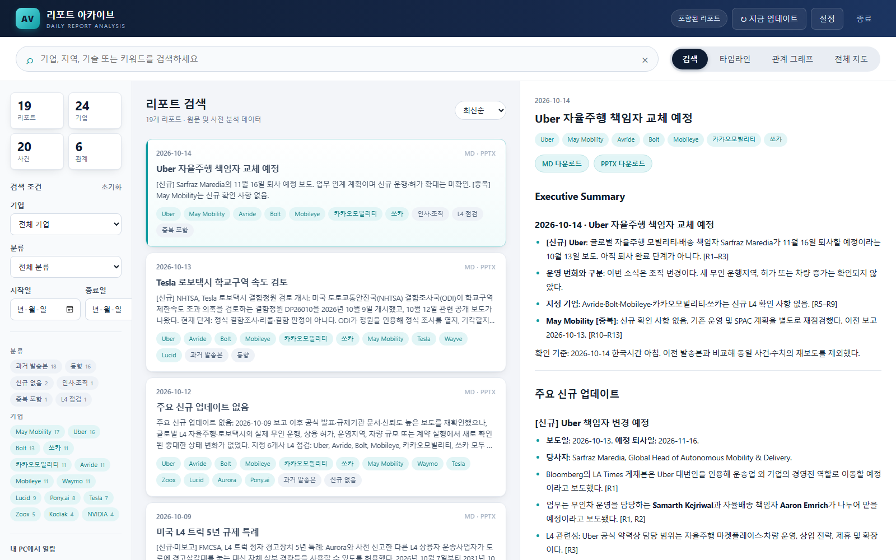
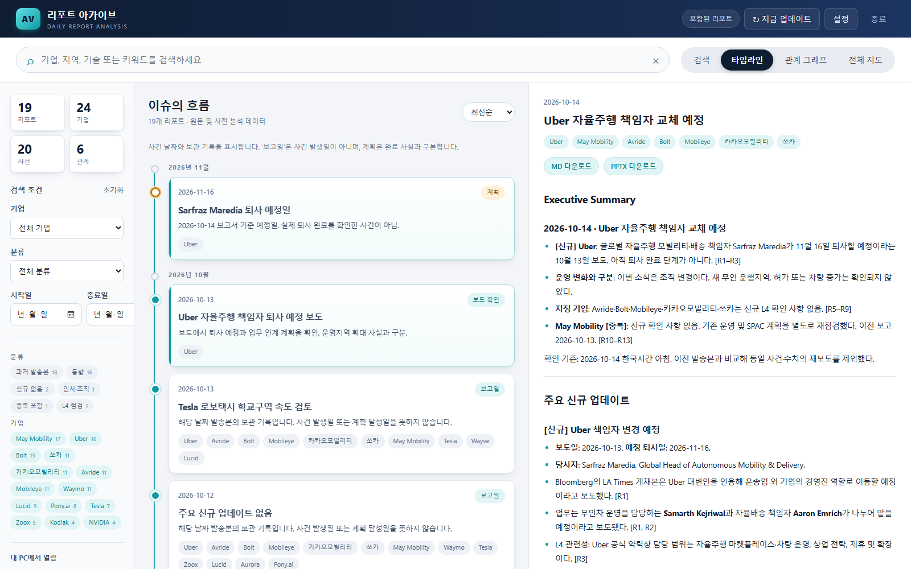
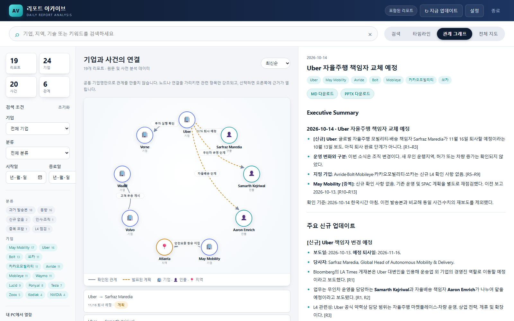
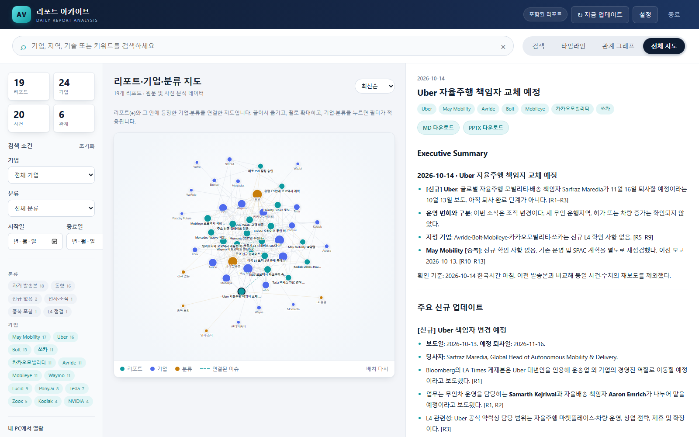

# AV Report Hub 시작 안내

**자율주행 데일리 리포트를 한 화면에서 찾아보는 프로그램입니다.** 메일함을 뒤지지 않고 회사명이나 키워드로 지난 리포트를 바로 검색하고, 사건의 흐름과 기업 관계를 확인할 수 있습니다.

이 문서는 개발 지식이 없는 분을 위한 안내입니다. 아래 세 가지만 알면 충분합니다.

메모와 분석을 남기려면 왼쪽 **노트 → 새 노트**를 사용하세요. 입력을 멈추면 Markdown 파일로 자동 저장되고, 편집·미리보기·Live Preview를 전환할 수 있습니다. 이미지, 태그, 리포트·노트 연결과 복구는 [노트 사용 안내](NOTES_GUIDE.md)를 참고하세요.

- **설치는 파일 하나를 더블클릭하면 끝납니다.** 다른 프로그램을 깔 필요가 없습니다.
- **회사 PC에서 AI를 실행하지 않습니다.** 이미 정리된 자료를 받아서 보여주기만 합니다.
- **인터넷이 끊겨도 받아 둔 리포트는 볼 수 있습니다.**

---

## 1. 설치하기 (약 1분)

### 1단계. 설치 파일 받기

아래 링크를 눌러 `AVReportHub-Setup.exe` 파일 하나를 받습니다.

**[AVReportHub-Setup.exe 내려받기](https://github.com/graycoral/DailyReportAnalysis/releases/latest/download/AVReportHub-Setup.exe)**

브라우저가 "이 파일은 일반적으로 다운로드되지 않습니다"라고 물으면 **유지** 또는 **계속**을 누릅니다.

### 2단계. 받은 파일 더블클릭

받은 파일을 더블클릭하면 아래 과정이 **자동으로** 진행됩니다. 아무것도 입력하거나 선택할 필요가 없습니다.

1. PC 환경 검사
2. 프로그램 설치
3. 리포트 자료 준비
4. 바탕화면에 **AV Report Hub** 바로가기 생성
5. 리포트 화면 열기

잠시 후 브라우저에 리포트 화면이 열리면 설치가 끝난 것입니다. "설치가 끝났습니다"라고 표시된 탭은 닫아도 됩니다.

### 파란색 경고 창이 뜬다면

이 프로그램은 아직 코드 서명이 없어서 처음 실행할 때 Windows가 아래와 같은 파란 창을 띄울 수 있습니다.

> **Windows의 PC 보호**
> Microsoft Defender SmartScreen이 인식할 수 없는 앱의 시작을 차단했습니다.

이때는 창 안의 **추가 정보**를 누른 뒤, 아래에 나타나는 **실행** 버튼을 누르면 됩니다. 이 확인은 처음 한 번만 합니다.

회사 보안 정책으로 실행 자체가 막혀 있다면 이 프로그램이 해제할 수 없습니다. 아래 [문의](#5-도움이-필요할-때) 항목을 참고하세요.

### 3단계. 다음부터는 바탕화면 바로가기

이후에는 바탕화면의 **AV Report Hub** 아이콘을 더블클릭하면 됩니다. 설치 파일은 지워도 됩니다.

---

## 2. 화면 둘러보기

목록과 본문 사이 **경계선을 좌우로 드래그**하면 각 영역의 너비를 조절할 수 있습니다. 조절한 비율은 이 브라우저에 저장됩니다. 경계선을 **더블클릭**하면 기본 비율로 돌아갑니다. 키보드로는 경계선에 Tab으로 이동한 뒤 좌우 방향키로 조절하고 Enter로 기본 비율을 복원합니다. 좁은 화면에서는 목록과 본문이 위아래로 표시됩니다.

**왼쪽 아이콘 메뉴**에서 데일리리포트·타임라인·관계·지도·Outlook·내 자료·AI 검색으로 이동합니다. **가운데**는 결과 목록, **오른쪽**은 선택한 자료의 본문입니다. 아이콘 아래 이름과 마우스를 올렸을 때의 설명으로 기능을 확인할 수 있습니다. 메뉴에서 위·아래 방향키로 이동할 수도 있습니다.

상단에는 **업데이트 신호등**, **마지막 업데이트 확인 시각(한국시간)**, **지금 업데이트** 버튼이 있습니다. 초록색 ✓는 확인 완료, 노란색 ↻는 확인 중, 빨간색 !는 연결 실패, 회색 −는 오프라인·설정 전·대기 상태입니다. 신호등을 누르면 자세한 상태를 볼 수 있습니다. 시각은 GitHub 확인에 마지막으로 성공한 시간이며, 자료 변경이 없어도 갱신됩니다.

왼쪽 **설정** 탭에서 화면 스타일(라이트·다크·클래식), GitHub 연결, 매일 자동 업데이트 시간을 바꿉니다. **종료** 버튼은 왼쪽 맨 아래에 있으며, 누른 뒤 확인하면 프로그램과 자동 갱신이 함께 종료됩니다.

**설정 → GitHub 자료 연동** 스위치로 연동 여부를 선택한 뒤 **검사하고 저장**을 누릅니다. 끄면 시작 시 확인·자동 업데이트·첨부 다운로드를 중단하고 GitHub 리포트와 관련 사건·관계를 목록에서 제외합니다. 처음 설치했을 때도 기본 리포트를 자동으로 넣지 않습니다. 이전에 받은 GitHub 파일은 보존하며 다시 연동하면 표시합니다. GitHub 연결이나 접근 권한에 문제가 생기면 연동이 자동으로 꺼지고 재실행해도 유지됩니다. 연결을 복구한 뒤 스위치를 켜고 저장하면 다시 확인합니다. Outlook·PDF·수동 MD 자료는 이 설정과 관계없이 사용할 수 있습니다.

**새 버전을 설치한 뒤 처음 실행하면** `GitHub 자료를 연동할까요?`를 묻습니다. **연동하기** 또는 **연동하지 않기**를 선택하면 같은 버전에서는 다시 묻지 않습니다. 닫거나 Esc를 누르면 지금은 연결하지 않고, 다음 실행에서 다시 선택할 수 있습니다. 설치된 버전은 PC에 저장한 값과 비교하므로 인터넷 없이 확인합니다. GitHub에 접속할 수 없는 상태에서 새 버전의 출시 여부를 확인하는 기능은 아닙니다.

검색창 아래 **검색 조건**을 누르면 기업·분류·기간을 설정할 수 있습니다. 조건을 접어도 적용 중인 조건이 남으며, 각 조건의 **×**로 해제하거나 **초기화**로 기본 상태로 돌릴 수 있습니다. 데일리리포트·타임라인·관계·지도 사이에서는 조건이 유지됩니다.

리포트·기업·사건·관계 수는 결과 제목 아래에 표시됩니다. 데일리리포트 목록의 **삭제**를 누르면 원본은 보관하면서 이 PC의 검색·타임라인·관계·지도에서 숨깁니다. **설정 → 삭제한 리포트 복원**에서 항목을 체크해 **선택 복원**하거나 **전체 복원**할 수 있습니다. 결과 상단의 **숨김 관리 → 설정에서 복원**으로도 이동합니다.

왼쪽 아래 **도움말**을 누르면 작은 팝업에 프로그램의 목적과 간단한 사용법이 표시됩니다. 팝업의 **자세한 도움말** 링크를 누르면 새 브라우저 탭에 상세 안내가 열립니다. 현재 사용 중인 탭의 설명부터 표시되며, 위쪽의 8개 탭 중 하나를 고르면 그 탭의 설명만 볼 수 있습니다. 팝업은 **×**나 **Esc**로 닫을 수 있고, 보던 리포트와 검색 조건은 유지됩니다.

**내 자료**에서는 PDF 파일명을 검색하며, **AI 검색**은 전용 검색창을 사용합니다. 두 화면에는 리포트용 검색 조건과 통계가 표시되지 않습니다.

PDF 목록은 파일명·추가일·크기를 간결한 행으로 표시합니다. 파일명 옆 **연결 리포트**를 누르면 연결할 리포트를 선택하거나 기존 연결을 해제할 수 있습니다. 옆의 **삭제**는 확인 후 이 PC에 보관한 PDF 사본과 연결 정보를 실제로 삭제합니다. PDF 삭제는 설정의 리포트 복원 대상이 아니며 되돌릴 수 없습니다.

**내 자료의 PDF를 선택하면 오른쪽에 미리보기**가 열립니다. PDF 도구 모음에서 페이지 이동·확대/축소를 하고, **크게 보기**로 넓은 창에서 읽을 수 있습니다. 확대 창은 닫기 버튼 또는 Esc로 닫습니다. 파일명 검색이나 리포트 연결 중에도 현재 미리보기는 유지됩니다. 브라우저에서 PDF가 표시되지 않으면 **새 탭에서 열기** 또는 **다운로드**를 사용하세요. 별도 프로그램이나 AI 검색 서비스 없이 이 PC에서 열람합니다.

**Outlook**에서는 **Outlook 연동**으로 메일함·PST·OST를 연결하고 가져올 폴더를 선택합니다. 연결 상태, 가져온 리포트, 리포트에 연결한 메일을 한곳에서 확인하며 제목·발신자·폴더로 검색합니다.

### 데일리리포트



- 맨 위 검색창에 **회사명, 지역, 기술, 키워드**를 입력합니다. 여러 단어를 띄어 쓰면 모두 들어 있는 리포트만 나옵니다.
- 찾은 단어는 목록과 본문에서 **노란색**으로 표시됩니다.
- 리포트 카드를 누르면 오른쪽에 본문이 열립니다.
- 카드나 **검색 조건 → 상세 옵션**의 **회사 이름 칩**(예: Uber, Waymo)을 누르면 그 회사 리포트만 남습니다. 다시 누르면 해제됩니다.
- **검색 조건**의 **시작일·종료일**로 기간을 좁힐 수 있습니다. ‘신규 확인 사항 없음’만 있는 언급의 제외 여부는 **상세 옵션**에서 바꿉니다.

### 타임라인



사건을 날짜순으로 보여줍니다. 오른쪽 위 표시의 뜻은 아래와 같습니다.

| 표시 | 뜻 |
| --- | --- |
| **보도 확인** | 실제로 보도된 사건 |
| **계획** | 발표만 됐고 아직 실행되지 않은 예정 |
| **보고일** | 그날 리포트가 발송됐다는 기록. 사건 발생일이 아닙니다 |

### 관계 그래프



기업, 인물, 지역 사이의 **근거가 확인된 관계만** 그림으로 보여줍니다. 같은 회사 이름이 나왔다고 선을 긋지 않습니다.

- 동그라미나 선 위에 마우스를 올리면 관련된 것만 밝게 표시됩니다.
- 선을 누르면 오른쪽에 **근거 문장과 출처**가 열립니다.
- 실선은 확인된 관계, 점선은 발표된 계획입니다.
- 아래 **자료 연결**에는 노트 본문의 링크, 노트에 직접 연결한 리포트, 원본 메일과 사용자가 직접 연결한 PDF·메일을 표시합니다. 연결을 누르면 원문과 연결 근거를 확인할 수 있습니다. 자료 연결은 기업·사건의 사실 관계와 구분합니다.

### 전체 지도



노트와 리포트, 기업, 분류를 하나의 지도로 펼친 화면입니다. 처음에는 전체 자료를 보여주며, 연결이 없는 노트도 포함합니다.

- 마우스 휠로 **확대·축소**, 끌어서 **이동**합니다.
- 파란 점(기업)이나 주황 점(분류)을 누르면 연결된 리포트가 오른쪽에 최신순으로 표시됩니다. 지도 위치와 검색 조건은 유지됩니다.
- 청록색 점(리포트)을 누르면 요약과 연결된 원본 메일·PDF 등의 목록이 표시됩니다. 목록에서 자료를 선택하면 원문을 열고, **관련 자료 목록** 버튼으로 돌아올 수 있습니다.
- AI 검색에서 색인한 PDF·이미지도 검색 서비스 실행 중에는 별도 자료 노드로 표시됩니다. 해당 점을 선택한 뒤 오른쪽 목록에서 자료를 열면 미리보기를 볼 수 있습니다.
- 보라색 점(내 노트)을 누르면 노트 미리보기가 열립니다. **노트 열기 · 편집**으로 수정할 수 있습니다. `[[노트 이름]]`과 직접 연결한 리포트는 점선으로 연결됩니다.
- 자료 사이의 주황색 점선은 임베딩 유사도입니다. 선택하면 비교한 두 자료의 페이지와 점수를 확인하며, 기업·사건의 확인된 사실 관계와 구분합니다.
- 엉켜 보이면 오른쪽 아래 **배치 다시**를 누릅니다.

관계 그래프와 전체 지도 상단의 **Outlook / 데일리 리포트 / 내 자료 / 내 노트** 스위치로 출처별 표시를 켜고 끕니다. 두 화면에서 같은 설정을 사용하며 이 브라우저에 기억합니다. 끈 자료의 노드와 연결선은 함께 숨겨집니다.

| 표시 스위치 | 포함되는 자료 |
| --- | --- |
| Outlook | Outlook에서 가져온 리포트, 원본 메일, 직접 연결한 메일 |
| 데일리 리포트 | 게시된 리포트와 직접 가져온 MD |
| 내 자료 | 암호화 보관한 PDF, AI 검색에 색인한 PDF·이미지 |
| 내 노트 | 현재 저장 폴더의 Markdown 노트, 노트 간 링크와 직접 연결한 리포트 |

전체 지도에서는 **보고일과 본문이 같은 리포트를 하나로 합치고**, 오른쪽 목록에 **데일리 · Outlook** 출처를 함께 표시합니다. 원본 메일과 직접 연결한 자료는 유지됩니다. 같은 날짜라도 본문이 다르면 별도 리포트로 표시합니다. 관계 그래프는 출처별 원본과 게시 근거를 유지합니다. 기업·분류·기간 조건은 리포트에 적용되고, 검색어는 파일명·연결 메일과 노트 제목·본문·태그에도 적용됩니다. 연결선은 양쪽 자료가 모두 표시될 때만 나타납니다. 노트와 보관 PDF는 검색 서비스 없이 표시되며, 색인 자료와 유사도는 서비스가 켜져 있어야 합니다. 임베딩 유사도는 전체 지도에서만 표시합니다.

### 오른쪽 본문 영역

- 리포트 본문이 가장 위에 나옵니다.
- 본문 위의 **MD 다운로드**, **PPTX 다운로드** 버튼으로 원본 파일을 받을 수 있습니다.
- 아래로 내리면 연결된 이슈, 같은 회사가 나온 다른 리포트, 원문 출처 링크가 있습니다.

---

### GitHub가 차단된 회사에서 자료 가져오기

GitHub 연결이 실패하면 상단 신호등이 빨간색으로 바뀌고 연동이 자동으로 꺼집니다. **설정 → GitHub 자료 연동**을 켜고 저장하면 다시 확인합니다. 연동을 끄거나 첫 실행 선택을 보류한 동안에는 **지금 업데이트** 버튼도 비활성화됩니다. GitHub 리포트는 표시하지 않으며, Outlook·직접 가져온 자료 열람과 아래 가져오기는 계속 사용할 수 있습니다.

**MD 파일:** 화면에 `.md` 파일을 끌어다 놓거나 상단의 **＋ 가져오기**를 누릅니다. UTF-8, 최대 2MB이며 [리포트 작성 형식](REPORT_FORMAT.md)을 따릅니다. 형식이 맞지 않으면 파일별 이유를 표시합니다. 동일한 내용은 중복 저장하지 않고, 같은 날짜의 다른 MD는 이 PC의 리포트를 갱신합니다.

**Outlook:** 왼쪽 `Outlook` → `메일함에서 리포트 가져오기`를 펼친 뒤 `Outlook 메일함 불러오기` → `폴더 선택` → `이 폴더 추가` 순서로 지정합니다. 설정 영역은 다시 접을 수 있습니다. PST·OST 파일은 `경로 추가` → Windows 파일 선택 창에서 파일 선택 → `열기`로 경로를 등록합니다. 경로를 알고 있다면 입력란에 붙여 넣고 `입력 경로 추가`를 눌러도 됩니다. 경로를 추가한 뒤에는 연결 목록에서 폴더를 선택하세요. 선택한 폴더만 확인하며 하위 폴더는 각각 선택해야 합니다.

- REPORT_FORMAT 형식에 맞는 **Markdown 본문 또는 UTF-8 MD 첨부**만 자동으로 가져옵니다. 일반 메일, 머리말·제목 구조가 사라진 HTML 메일, 형식에 맞지 않는 첨부는 리포트로 저장하지 않습니다. HTML 메일은 형식이 유지된 `.md` 파일을 첨부해 주세요.
- 폴더명이 분류 태그가 됩니다. 기업 태그는 메일 제목에 적힌 알려진 기업명만 사용합니다. 본문으로 태그를 만들지 않습니다.
- 프로그램 실행 중 5분마다 확인합니다. 처음에는 기존 메일을 나누어 확인하며, 남은 메일은 30초 간격으로 이어서 처리합니다. **지금 가져오기**로 즉시 확인할 수도 있습니다. 설정을 접어도 진행 상태는 보입니다.
- 형식이 맞는 Outlook 자료는 **데일리리포트에도 표시**합니다. 보고일과 본문이 같으면 한 번만 표시하고 게시된 자료를 우선합니다. 머리말 설정·줄바꿈·줄 끝 공백 차이는 무시합니다. 같은 날짜라도 본문이 다르면 구분해서 볼 수 있습니다. 수동 MD와 Outlook은 따로 보관하므로 서로 덮어쓰지 않습니다.
- **Outlook에서 가져온 리포트** 목록에는 가져온 자료와 `데일리에 추가됨` 또는 `중복 · 데일리에 있음` 상태가 표시됩니다. 리포트를 누르면 본문과 원본 메일을 확인할 수 있습니다. 관계·전체 지도에서는 Outlook·데일리 리포트·내 자료 스위치로 출처별 자료를 함께 보거나 제외합니다.
- 가져온 자료는 이 PC의 현재 Windows 계정으로 암호화해 보관합니다. GitHub에 올라가지 않으며, 프로그램 재실행과 GitHub 갱신 후에도 유지됩니다. **연결 해제**는 해당 폴더의 자동 가져오기 연결을 끊습니다. Outlook 원본과 이미 가져온 리포트는 남으며, 메일함은 다시 연결할 수 있는 후보 목록에 계속 표시됩니다.
- 데일리 목록에서 숨긴 자료는 같은 내용의 게시 자료가 나중에 들어와도 다시 나타나지 않습니다. 설정에서 원래 숨긴 항목을 복원하면 다시 표시됩니다. PDF·메일에서 연결 리포트를 열 때는 중복 여부와 관계없이 연결한 원본을 확인할 수 있습니다.
- 클래식 Outlook이 설치·설정되어 있어야 합니다. 새 Outlook과 회사 정책에 의한 PowerShell 제한 모드는 지원하지 않습니다.

### 모델 없이 자료 연결하기

검색창 옆 **자료 연결**을 누릅니다. GitHub·RAG·언어모델 없이, 이 PC에 보관한 리포트·PDF와 선택한 Outlook 폴더의 메일 정보를 비교합니다.

1. Outlook에서 폴더를 선택하고 **지금 가져오기**를 누릅니다. 기존 폴더도 기능 추가 후 처음에는 과거 메일부터 나누어 확인합니다. PDF는 **내 자료**에 추가합니다.
2. **자료 연결 → 추천**에서 두 자료와 연결 이유를 확인합니다. 자료 제목을 누르면 리포트·PDF·Outlook 원문을 엽니다.
3. **연결 확정**을 누르면 관계·전체 지도에 ‘확정한 자료 연결’로 표시합니다. **추천 제외**를 누르면 재실행 후에도 같은 자료 쌍을 다시 추천하지 않습니다.
4. **확정 / 제외** 목록의 **판단 취소 · 다시 추천**으로 되돌릴 수 있습니다. 사전이나 제목이 바뀌어도 저장한 판단과 당시 근거는 유지됩니다.
5. **기업·프로젝트 사전**에서 대표 이름과 다른 이름을 등록합니다. 예: `현대자동차` / `현대차, Hyundai Motor`. 사전 저장으로 후보를 다시 계산합니다. 오류가 있으면 입력한 내용은 유지됩니다.

메일 대화 ID, 동일 문서 파일의 SHA-256, `AV-2026-004` 같은 번호, 등록한 프로젝트명이 강한 연결 근거입니다. 기업명만 같거나 날짜만 가까운 자료는 추천하지 않습니다. 기업명·제목 핵심어·날짜를 조합하며, 이 점수는 추천 순서용이지 사실 확인 확률이 아닙니다. 후보가 많으면 최근 이웃 자료를 비교해 근거가 강한 최대 300개를 우선 표시합니다.

메일 제목·첨부파일 이름, 리포트 제목, PDF 파일명을 사용합니다. 일반 메일 본문과 PDF 본문의 의미를 분석하지 않습니다. 첨부 지문은 MD·PDF·Word·PowerPoint·Excel·TXT·CSV 문서만 확인하며, 메일당 최대 32개·합계 50MB입니다. 읽지 못한 첨부와 초과분은 동일 파일 비교에서 제외합니다. 문서 사본을 임시 파일로 만들지 않습니다.

사전·판단·메일 메타데이터는 `local/connections.bin`에 현재 Windows 계정으로 암호화 보관합니다. GitHub 자료와 분리되며 일반 메일 본문·첨부 사본은 저장하지 않습니다. 메일 정보는 마지막 확인 시점의 기록이므로 Outlook에서 삭제·이동된 원본은 열리지 않을 수 있습니다. 폴더 연결을 해제하면 해당 폴더의 자동 수집 메일은 추천에서 제외됩니다. 직접 리포트에 연결한 메일과 이미 가져온 리포트는 유지됩니다.

확정한 선은 **관련 자료라는 사용자 판단**입니다. 기업 간 협력·투자 사실을 자동 생성하거나 공개 관계 데이터에 합치지 않습니다. 지도 출처 스위치·검색 조건으로 양쪽 자료가 표시될 때만 연결선이 보입니다.

## 3. 자주 하는 질문

**오늘 리포트가 안 보여요.**
GitHub 자료 연동이 켜져 있으면 매일 **오전 8시(한국시간)** 이후에 새 자료를 자동으로 받습니다. 그 시간에 PC가 꺼져 있었거나 프로그램이 실행 중이 아니었다면 바탕화면 아이콘을 다시 실행하세요. 연동 여부를 선택한 버전에서는 실행하면 바로 최신 자료를 확인합니다. 오른쪽 위 **지금 업데이트** 버튼으로 직접 확인할 수도 있습니다.

**브라우저 창을 닫았는데 프로그램이 계속 켜져 있어요.**
정상입니다. 창을 닫아도 프로그램은 뒤에서 실행되며 정해진 시간에 자료를 받습니다. 완전히 끝내려면 화면 왼쪽 맨 아래의 **종료**를 누르세요. 바탕화면 아이콘을 다시 누르면 실행 중인 화면이 다시 열립니다.

**특정 회사 소식만 모아 보고 싶어요.**
상단 **검색 조건**의 "기업" 목록이나 카드에 있는 회사 이름 칩을 누르세요. 타임라인·관계·지도 탭으로 바꿔도 필터는 유지됩니다.

**지난달 리포트의 PPT 파일이 필요해요.**
검색이나 타임라인에서 해당 날짜 리포트를 선택한 뒤 오른쪽 위 **PPTX 다운로드**를 누르세요.

**인터넷이 안 되는 곳에서도 쓸 수 있나요?**
네. 이미 받아 둔 리포트는 검색과 열람이 됩니다. 새 자료 받기와 원문 출처 링크 열기만 인터넷이 필요합니다.

**프로그램을 새 버전으로 바꾸려면?**
새 `AVReportHub-Setup.exe`를 받아 다시 더블클릭하면 됩니다. 실행 중인 프로그램은 설치 과정에서 자동으로 종료됩니다. 저장된 자료와 설정은 그대로 유지됩니다.

**회사 PC에 뭔가 설치되나요?**
내 계정 폴더(`%LOCALAPPDATA%\AVReportHub`) 안에만 파일이 들어갑니다. 관리자 권한을 요구하지 않고, Git·Python 같은 개발 도구도 설치하지 않습니다. 제거하려면 그 폴더와 바탕화면 바로가기를 지우면 됩니다.

**이 프로그램이 AI로 리포트를 만드나요?**
아닙니다. 리포트 조사와 분석은 별도의 외부 환경에서 미리 끝내고, 이 프로그램은 그 결과를 **받아서 보여주기만** 합니다. 회사 PC에서 AI를 실행하거나 외부 AI 서비스에 연결하지 않습니다.

---

## 4. 설치나 실행이 안 될 때

| 화면에 나오는 안내 | 해 볼 것 |
| --- | --- |
| 파란 SmartScreen 경고 | **추가 정보 → 실행** |
| GitHub 연결 불가 | 연동이 자동으로 꺼지고 GitHub 리포트는 표시하지 않습니다. Outlook·직접 가져온 자료는 계속 볼 수 있습니다. 연결·접근 권한을 확인한 뒤 설정에서 **GitHub 자료 연동**을 켜고 저장하세요 |
| 실행 파일 설치 불가 | 열려 있는 AV Report Hub 화면에서 **종료**를 누른 뒤 설치 파일을 다시 실행 |
| 바로가기 생성 제한 | 아래 위치의 파일을 직접 실행하세요. 탐색기 주소창에 붙여넣으면 됩니다 |

```
%LOCALAPPDATA%\AVReportHub\bin\AVReportHub.exe
```

문제가 반복되면 같은 폴더의 `app.log` 파일을 담당자에게 보내 주세요. 이 파일에는 비밀번호나 메일 내용이 들어가지 않습니다.

---

## 5. 도움이 필요할 때

- 설치나 사용 방법 문의: 프로그램 배포 담당자
- 회사 보안 정책으로 실행이 차단된 경우: 사내 IT 담당자에게 "서명되지 않은 사내 배포 프로그램 실행 허용"을 요청
- 프로그램 구조나 데이터 형식 등 자세한 내용: [프로젝트 상세 설명서](PROJECT_GUIDE.md)

기준 버전: v0.1.5 · Windows 10/11 64비트
